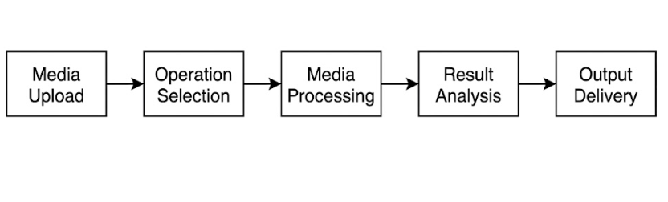
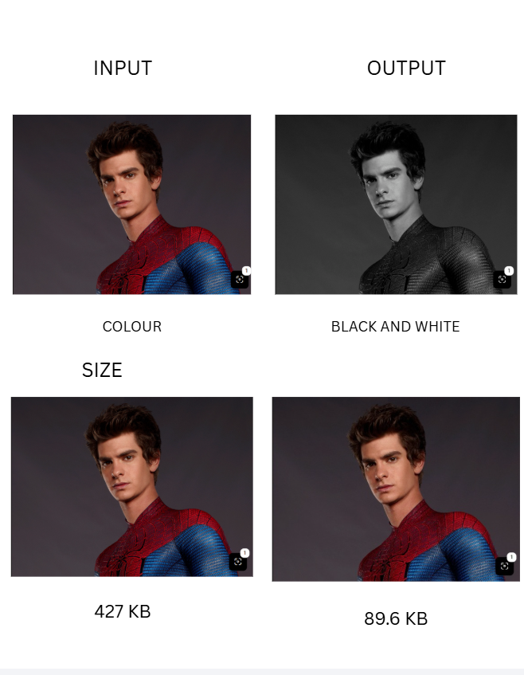
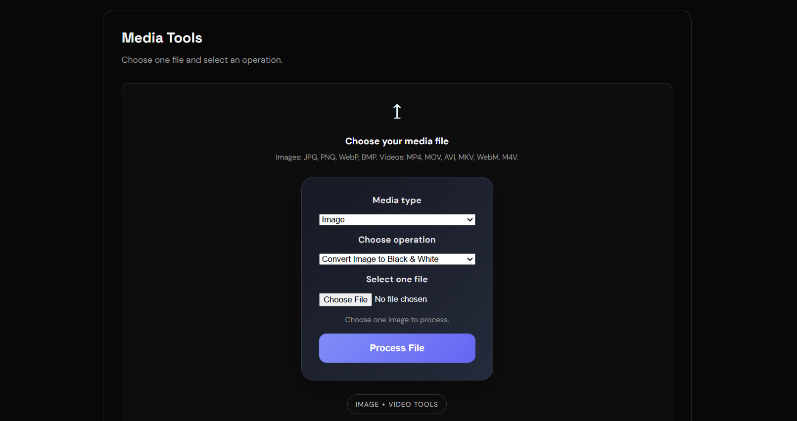
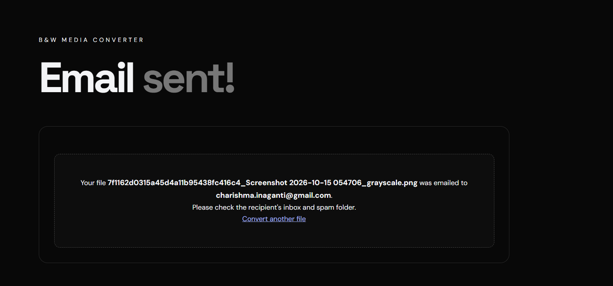

# B&W Media Converter

## 1. Methodology

## 2. Description

B&W Media Converter is a web-based application developed using Python and Flask to process images and videos through grayscale conversion and compression. It allows users to analyze file-size differences and download or email the processed media.

## 3. Input and Output

## 4. Live Link

http://127.0.0.1:5000/

## 5. Screenshot of the Interface

### Homepage

### Results Page

## Screenshot of the Interface

### Methodology

### Input and Output

### Input

### Output
